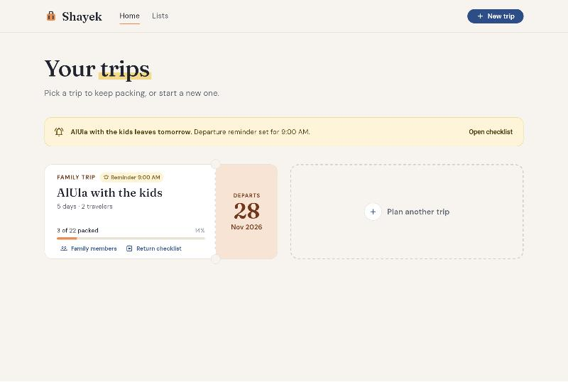
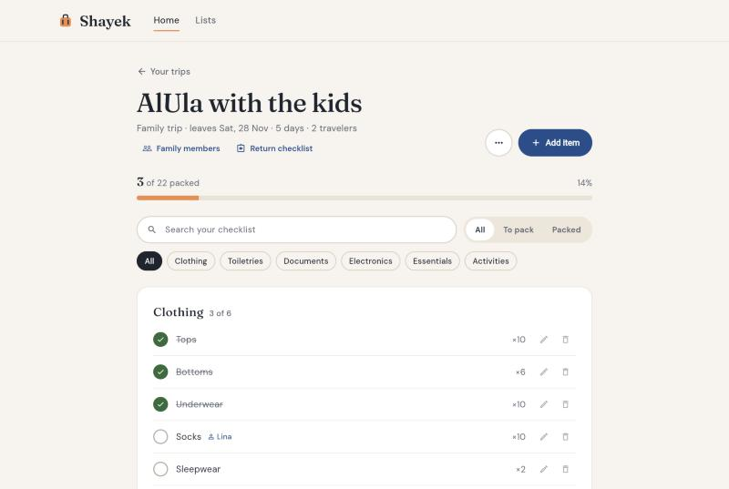
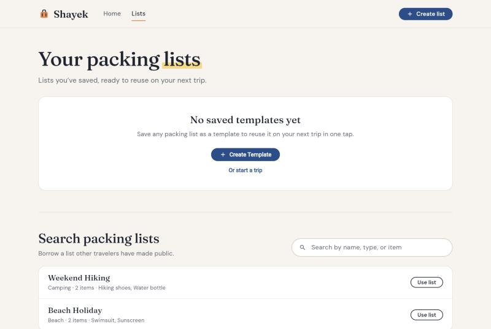

# Shayek – Smart Trip Packing Assistant

**SWE 463 · Group 03**

Travelers often forget items or rebuild the same packing list for every trip. Shayek is a Flutter app that generates a packing checklist from a trip's details, tracks what is packed, and saves lists as reusable templates.

## Features

| Feature | Type | Status |
|---|---|---|
| Trip creation with form validation | Essential | Completed |
| Generated packing checklist | Essential | Completed |
| Checklist management (add, edit, delete, categorize, mark packed, search, filter) | Essential | Completed |
| Reusable packing templates (lists) | Essential | Completed |
| Family members and item assignment | Optional | Completed |
| Shared items | Optional | Completed |
| Return checklist | Optional | Completed |
| Departure reminder (shown in the app on Home) | Optional | Completed |
| Reminder push notifications | Optional | Not completed |

## Project structure

The Flutter app is in `shayek/`:

```text
shayek/
  lib/
    main.dart
    app_routes.dart
    models/
    providers/
    database/
    screens/
    theme/
    widgets/
  test/
```

Screens use Providers for state; Providers use repositories in `database/` for persistence.

## Setup and run

Requires the Flutter SDK. No configuration, environment variables, or API keys are needed.

```bash
cd shayek
flutter pub get
flutter run -d chrome
```

Use `flutter devices` to choose another target, e.g. `flutter run -d <device-id>`.

## Packages

| Package | Why it is used | License |
|---|---|---|
| `provider` | Shared app state across screens | MIT |
| `sqflite` | Local SQLite database | BSD-2-Clause |
| `sqflite_common_ffi_web` | SQLite storage for the web build | BSD-2-Clause |
| `path` | Database file path | BSD-3-Clause |
| `cupertino_icons` | Flutter template default | MIT |
| `flutter_lints` (dev) | Analyzer lint rules | BSD-3-Clause |

## Data, persistence, and state

- **Data source:** local data entered by the user, plus two built-in example public lists ("Weekend Hiking", "Beach Holiday") in `TemplateProvider`.
- **Persistence:** SQLite through `sqflite`; on the web, IndexedDB through `sqflite_common_ffi_web`. Trips, checklist items, templates, family members, and reminder settings are saved.
- **State management:** `provider` with `ChangeNotifier` (`TripProvider`, `ChecklistProvider`, `TemplateProvider`, `TravelerProvider`). Screens use providers; providers use repositories in `lib/database/`.

## Screenshots

| Home | Packing checklist | Lists |
|---|---|---|
|  |  |  |

## Testing

Automated tests, from `shayek/`:

```bash
flutter analyze
flutter test
```

Manual test of the main flow:

1. On Home, select **New trip**, fill in the form, and select **Generate Packing List**.
2. On the checklist, mark items as packed and add or edit an item.
3. Return to Home and confirm the trip card shows the packed count.
4. Open **Family members** and **Return checklist** from the trip card.
5. On the checklist, open ⋯ → **Save as list**, then confirm the list appears under **Lists**.

## Known limitations

- The departure reminder appears inside the app only; no push notifications are sent.
- On the web, data is stored per browser origin and port.
- No sign-in or cloud sync.

## Team contributions

| Member | Student ID | Contribution | Evidence |
|---|---:|---|---|
| Naba Alali | 202268320 | Trip creation and form validation | Commits on `create-trip-Naba` (e.g. `dbd4b32`, `cceac8a`) |
| Rayhanah Alobaid | 202243580 | Home page, navigation, UI design | Commits on `HomePage_Rayhanah` (e.g. `7e56448`, `a66c162`) |
| Zahra Almadeh | 202254580 | Packing checklist, persistence, family and return checklist logic | PRs #1, #2, #4 (e.g. `a599cbd`, `3bff5f1`) |
| Atheer Almomtan | 202246520 | Templates (Lists) page | PR #3 (`3eb5633`) |

## Repository

[SWE-463 Project Group 03](https://github.com/Zahraaalmadeh/SWE-463-Project-Group03)

## Sources, licenses, and AI disclosure

- **Fonts:** Fraunces and DM Sans from Google Fonts (SIL Open Font License 1.1), in `shayek/assets/fonts/`.
- **Icons:** Material Icons from the Flutter SDK.
- **Code and datasets:** no external code or datasets; packing suggestions and sample lists were written by the team.
- **AI use:** AI was used for setup guidance, debugging, UI implementation suggestions, tests, and documentation. The team reviewed and tested all changes.
